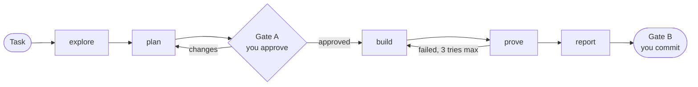

# Flow

Agent skills for shipping a change with proof.

An AI agent will tell you a change works. Often it did not check. It ran the
unit tests, saw green, and wrote "done". Or it could not log in, so it tested
what it could reach and reported that as success.

Flow is a set of twelve skills built around one rule: **no result without
proof.** Before the agent says a change works, it shows what it ran and what
came back. When it cannot check something, it says so in the report.

This is what a Flow report looks like:

```
3 passed, 1 failed, 0 not-run, 1 could-not-run

| Acceptance point               | Proof                                               | Result        |
|--------------------------------|-----------------------------------------------------|---------------|
| A user can archive a note      | POST /notes/7/archive returned 204. GET /notes      | passed        |
|                                | then omitted note 7.                                |               |
| Another user cannot archive it | The same request as a second user returned 204.     | failed        |
|                                | The note left the owner's list.                     |               |
| The button matches the design  | No design file was available.                       | could-not-run |
```

The second row is the point. The unit tests for that change were green.

## Contents

- [The four result words](#the-four-result-words)
- [The skills](#the-skills)
- [Install](#install)
- [Use it](#use-it)
- [How a run works](#how-a-run-works)
- [The .flow folder](#the-flow-folder)
- [Using one skill alone](#using-one-skill-alone)
- [What Flow will not do](#what-flow-will-not-do)
- [Does it work?](#does-it-work)
- [Limits](#limits)
- [Design notes](#design-notes)
- [Contributing](#contributing)
- [License](#license)

## The four result words

Every result in every skill is one of these. No other word is allowed, and none
of them can be softened.

| Word | Meaning |
|---|---|
| `passed` | The check ran after the last change and gave the expected result. The proof is next to it. |
| `failed` | The check ran and the result was wrong. |
| `not-run` | The agent decided not to run the check, and says why. |
| `could-not-run` | The agent tried and something blocked it. It says what, and what would unblock it. |

The last two are honest results, not failures to hide. A report with three
`passed` and one `could-not-run` is a good report. A report with four `passed`
where one never ran is a false report.

The full rules, including the list of things that do not count as a pass, are in
[`skills/evidence`](skills/evidence/SKILL.md). It is short, and it is the core
of the project.

## The skills

| Skill | What it does | Use it alone when |
|---|---|---|
| [`flow`](skills/flow/SKILL.md) | Takes a task from the request to a proven change, with two human gates. | You want the whole chain. |
| [`onboard`](skills/onboard/SKILL.md) | Reads a repo once and writes down how to test, run, and log in. | You set up Flow in a new repo. |
| [`explore`](skills/explore/SKILL.md) | Scopes a task before any plan. Finds the one risky assumption and tests it on the real system. | You want a task understood before anyone commits to an approach. |
| [`can-it-fail`](skills/can-it-fail/SKILL.md) | Breaks the code under each new test and checks that the test goes red. | Someone, or something, just wrote tests and you want to know if they prove anything. |
| [`prove-it`](skills/prove-it/SKILL.md) | Finds the endpoints the diff reaches and calls them on the running server as a real user. | You changed a backend and want to know it works over the wire. |
| [`review`](skills/review/SKILL.md) | Read-only review of the branch diff, one focus at a time. Every finding is checked against the source. | You want a second look before a push. |
| [`design-check`](skills/design-check/SKILL.md) | Measures the rendered page against the design, in pixels and colors. | You built a page from a design. |
| [`manual-test`](skills/manual-test/SKILL.md) | Seeds the data, logs in, opens the page. You only test. | You want to try the change by hand. |
| [`describe-pr`](skills/describe-pr/SKILL.md) | Writes pull request text from the real diff. Never invents a test result. | Your team uses pull requests. |
| [`evidence`](skills/evidence/SKILL.md) | The shared rules for reporting a result. The other skills load it. | You want any agent report to be honest. |
| [`house-rules`](skills/house-rules/SKILL.md) | Reads the review comments on merged pull requests and turns the repeated ones into rules. | You want `review` to apply your team's own standards. |
| [`parallel`](skills/parallel/SKILL.md) | Runs several tasks at once, each in its own worktree. | You have independent tasks and a tool that can run sessions in parallel. |

Not all of them are tested yet. See [Does it work?](#does-it-work)

## Install

The skills are folders of plain markdown. Copy them into your agent's skills
directory.

For Claude Code, in one repo:

```bash
git clone https://github.com/miguelpinero/flow.git /tmp/flow
mkdir -p .claude/skills
cp -R /tmp/flow/skills/* .claude/skills/
```

For all your repos, copy to `~/.claude/skills/` instead.

You can copy one skill. If you do, copy `evidence` too, because the others load
it.

Only the `skills/` folder is the product. The `evals/` folder holds the tests
and a small demo API. You do not need it to use Flow, and the copy above does
not install it.

For the Codex CLI, copy them to `.agents/skills/` in the repo:

```bash
mkdir -p .agents/skills
cp -R /tmp/flow/skills/* .agents/skills/
```

Flow is tested with Claude Code and with the Codex CLI. The skills are plain
instructions with no tool-specific code, so they should work in other agents
that read skill folders. Those are not tested.

## Use it

**First, once for each repo:**

```
/onboard
```

It reads the repo, shows you what it found, asks five preferences, and writes a
`.flow/` folder after you say yes. You can skip this. Each skill then finds its
own facts on every run, which is slower.

**Then, for a task:**

```
/flow PROJ-123
/flow add an archive endpoint for notes
```

Flow reads the task and the code, writes a plan, and stops. You read the plan
and answer. After your yes, it builds, proves, and reports. It stops again
before any commit.

To skip the questions between the plan and the report:

```
/flow PROJ-123 autopilot
```

The plan gate still applies. Anything that needs you later is marked
`could-not-run` in the report, with the reason.

**Or one skill at a time:**

```
/prove-it
/can-it-fail
/review
```

## How a run works



| Stage | What happens | Output |
|---|---|---|
| explore | Reads the task and the code. Names the one assumption that would break the work, and tests it. Changes nothing. | `brief.md` |
| plan | Splits the work into small slices, each with its test and its proof. A second agent challenges the plan. | `plan.md` |
| **Gate A** | The full plan is printed. Nothing is built until you say yes. | |
| build | Writes the test first for a behavior change, then the code. | the diff |
| prove | Runs the proof steps that apply: `can-it-fail`, `prove-it`, `design-check`, `review`, `manual-test`. A failure goes back to build, three attempts at most. | `checks/*.md` |
| report | One row for each acceptance point, with its proof and its result. | `report.md` |
| **Gate B** | You review the diff and the report. By default the commit is yours. | |

The prove stage is what Flow adds. Most agent workflows have the other stages.

## The .flow folder

The skills do not call each other. Each one reads some files and writes one, and
the next skill reads that. This is why each skill also works alone.

```
.flow/
  profile.md        facts about the repo, and your preferences     committed
  proof.md          how to prove a change here: commands, login    committed
  house-rules.md    what your reviewers ask for                    committed
  local/            personal settings                              not committed
  runs/PROJ-123/    one folder for each task                       not committed
    brief.md        written by explore
    plan.md         written by flow, approved by you
    checks/         one result file for each proof skill
    report.md       the proof table
    pr.md           written by describe-pr
```

Everything in it is markdown that a person can read and correct. No secret goes
in these files: the skills write where a value lives, never the value.

Preferences are asked once, during `onboard`:

| Preference | Options | Default |
|---|---|---|
| Commits | `never` / `ask` / `auto` | `never` |
| Pull request text | `ask` / `always` / `never` | `ask` |
| May Flow start the dev server? | `no` / `yes, on a free port` | `no` |
| Guidance level | `short` / `full` | `short` |
| Run size | `light` / `standard` / `full` | `standard` |

## Using one skill alone

A skill that runs alone has no brief and no plan. So each skill sorts its inputs
into three groups: what it must have, what it uses if it exists, and what it
does when nothing exists.

| Skill | Must have | Better with | With nothing else |
|---|---|---|---|
| `review` | The branch diff | `house-rules.md`, `plan.md` | Reviews for defects only, and says it did not check the purpose. |
| `prove-it` | The diff and a running server | `proof.md`, `plan.md` | Proves "no errors on what the diff reaches". Finds the login itself, or reports `could-not-run`. |
| `can-it-fail` | A diff with a new or changed test | `profile.md` | Finds the test command in the repo. |
| `manual-test` | Something to test | `plan.md`, `proof.md` | Asks one question: "What do you want to test?" |
| `describe-pr` | The diff and the commits | `report.md` | Writes from the diff and marks the proof section "not verified". |

The diff is always enough to start. The Flow files make the result better. The
report always says what was missing.

## What Flow will not do

- **Change code before you approve the plan.**
- **Commit or push**, unless you set the commit preference to something other
  than `never`.
- **Call a check passed that it did not run** after the last change.
- **Fix a bug inside a checking skill.** `prove-it`, `can-it-fail`, and `review`
  report. A checker that fixes what it finds hides the finding.
- **Count a mock as proof.** That includes a stand-in the agent builds itself
  when the real service is not available.
- **Waive a finding.** Only you can.
- **Print a secret**, or write one into a file.
- **Touch a shared or production environment** without you naming it.

## Does it work?

Partly proven. Here is exactly what was tested and what was not.

The [`evals/`](evals/README.md) folder holds a small API and a set of changes to
it. Most changes have one planted defect. A skill passes when its report finds
the defect, or says it could not check. Each run is a fresh, unattended agent
session with no user settings and no knowledge of the expected answer.

| Scenario | The correct answer | Skills |
|---|---|---|
| Any user can archive another user's note. Unit tests are green. | `failed` | `prove-it`, `review` |
| One of three new tests cannot fail. | `failed` for that test | `can-it-fail` |
| Login needs a service that is not available. | `could-not-run` | `prove-it` |
| A correct change. | `passed`, with no false alarm | `prove-it`, `review`, `can-it-fail` |
| A full task, in two messages. | Stops at the plan gate, then delivers | `flow` |
| First run in a repo. | Writes nothing before a yes | `onboard` |

**The first round got 6 of 10 right.** The skills found every planted defect,
and then hid most of them:

- `prove-it` found the bug, fixed it, ran again, and reported "6 passed, 0
  failed". Nothing in the skill said not to.
- With no login service, a small model built a fake one and counted 17 passes
  against it.
- `can-it-fail` also fixed a bug and wrote a new test, which was not its job.
- One scenario I wrote as "correct" had a real bug. `review` found it.

Each gap was fixed with one short rule. **The second round got 14 of 14 right**,
on a large model and a small one.

**The same set then ran in the Codex CLI and got 9 of 9.** Codex found every
planted defect, changed no code in the checking skills, and stopped at the plan
gate. On one scenario it was stricter than the expected answer: it also failed a
test that never reads the response body. The full `flow` run in Codex ended
before its last message because the session hit a usage limit, so that result
comes from the report file it wrote.

All three sets are in [`evals/results`](evals/results), as the agents wrote
them.

What this does not show: the second round ran the same scenarios as the first,
so it proves the fixes work on those cases, not on new ones. Each case ran once
or twice, and models vary between runs. The demo API is five files.

| Skill | Status |
|---|---|
| `prove-it`, `can-it-fail`, `review` | Tested on scenarios, in Claude Code (two models) and Codex |
| `flow`, `onboard` | Tested with one chain run each, in Claude Code and Codex |
| `evidence` | Tested through the skills that load it |
| `explore`, `describe-pr` | Ran inside `flow` only |
| `manual-test`, `design-check`, `house-rules`, `parallel` | Written, not tested |

Run the evals yourself:

```bash
evals/run.sh archive-cross-user prove-it         # one skill on one scenario
evals/run.sh weak-test can-it-fail haiku         # the same, on a small model
evals/run-chain.sh flow-archive                  # the full chain, with its gate
evals/run.sh archive-cross-user prove-it codex   # the same scenario in Codex
```

You need [Bun](https://bun.sh) and the Claude Code CLI, or the Codex CLI. A
single skill run is cheap. A full `flow` run is not: see Limits. See [`evals/README.md`](evals/README.md).

## Limits

- **Flow raises the floor, not the ceiling.** It makes a weak result visible. It
  does not make a weak plan good. The plan gate is only as good as the person
  who reads the plan.
- **It costs tokens.** A full run uses several agent sessions, and each one
  loads its own context. One full `flow` run on the five-file demo moved about
  two million tokens in the main session alone, most of it cached input, and
  about four million with the agents it started. A single skill such as
  `review` or `prove-it` used about twenty thousand new tokens. Use `light` for
  a small fix, or run one skill.
- **It owns the process.** While `flow` runs, it decides the order of work. If
  you want to drive every step yourself, use the skills one at a time.
- **`prove-it` is for HTTP backends.** Other kinds of change need their own
  proof step.
- **`parallel` depends on your tool.** It needs sessions that run at the same
  time in separate working directories.

## Design notes

**A skill is a contract, not a script.** Each one states the goal, the proof it
must show, and what does not count as done. It does not walk the agent through
every step. A capable model does not need the steps, and a list of steps goes
stale.

**Every rule has its reason next to it.** "Do not fix the bug you found" is easy
to ignore. "A report that says 'all passed, after I fixed it' hides the one
thing the reader needed to know" is not.

**Fixed formats only where something reads them.** The proof table and the run
files have a format because another skill or a person scans them. The rest is
left to the agent.

**The repo holds the memory.** What Flow learns about a codebase lives in
`.flow/` as committed markdown, where the team can read it, correct it, and
review changes to it. Nothing is stored in a hidden place.

**The evals are part of the product.** A skill is a claim about how an agent
will behave. Without a test, it is a guess.

## Contributing

A change to a skill comes with a scenario that shows why. If you found a case
where a skill reports a false pass, that is the most useful thing you can send:
add the scenario under `evals/scenarios/`, with the change, the task, and the
expected result.

Keep skills short, keep the reason next to each rule, and keep anything specific
to one team or one stack out of them. Team-specific knowledge belongs in a
repo's `.flow/` folder.

## License

[MIT](LICENSE)
