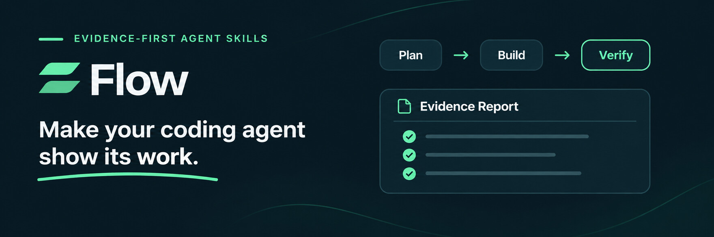
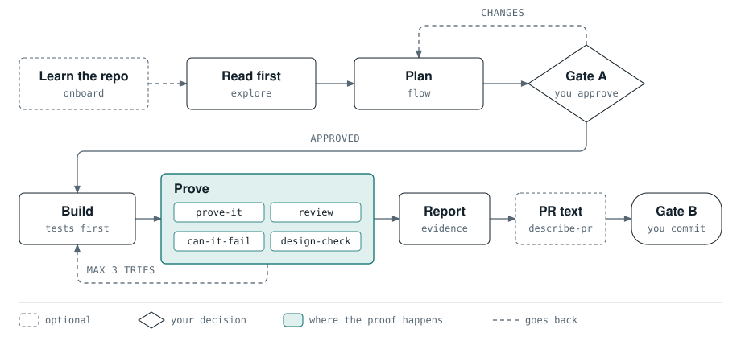

<p align="center">
  
</p>

# Flow

**Your coding agent can write the code. Flow makes it show the proof.**

Flow is a collection of **12 portable agent skills for Claude Code and Codex** that turns a task into a reviewable change: explore the problem, agree on a plan, build, verify what actually ran, and report what couldn't be checked.

No new coding agent. No Flow server to host. Just Markdown skills you can inspect, adapt, and use in the tools you already work with.

**The rule: no `passed` without proof.**

## See the difference

A green test suite is useful. It isn't the same as proving a change works for a real user.

Consider a new endpoint that archives a note. The agent writes the endpoint and unit tests; everything is green. But a second user can archive someone else's note. Or the agent can't reach the identity service and silently substitutes a mock.

Flow is designed to expose both cases instead of calling them done:

| Acceptance point | Evidence | Result |
|---|---|---|
| The owner can archive a note | `POST /notes/7/archive` returned `204`; the note disappeared from their list | `passed` |
| Another user cannot archive it | A second user got `204`, but the expected result was `404` | `failed` |
| The page matches the design | No design file was available to compare | `could-not-run` |

*Illustrative output based on the scenarios in [`evals/`](evals/README.md). A real Flow report includes the commands, responses, and remaining gaps relevant to your change.*

A failure is not a bad report. **An untested case presented as a pass is.**

## Get started

You need Git and **[Claude Code](https://code.claude.com/docs/en/overview)** or **[Codex](https://learn.chatgpt.com/docs/cli)**. Flow's skills are Markdown files; you don't need to install a separate Flow runtime.

<details open>
<summary><strong>Claude Code</strong></summary>

From the root of the project where you want to use Flow:

```bash
git clone https://github.com/miguelpinero/flow.git /tmp/flow
mkdir -p .claude/skills
cp -R /tmp/flow/skills/* .claude/skills/
```

Open Claude Code in that project, then:

```text
/onboard
/flow add an archive endpoint for notes
```

Or run a single check on your existing branch:

```text
/prove-it
/review
/can-it-fail
```

To make skills available in every repository, install them in `~/.claude/skills/` instead.

</details>

<details>
<summary><strong>Codex</strong></summary>

From the root of the project where you want to use Flow:

```bash
git clone https://github.com/miguelpinero/flow.git /tmp/flow
mkdir -p .agents/skills
cp -R /tmp/flow/skills/* .agents/skills/
```

Then invoke the skills in Codex with the `$` prefix:

```text
$onboard
$flow add an archive endpoint for notes
```

For a focused check, invoke `$prove-it`, `$review`, or `$can-it-fail`. You can also discover available skills through Codex's `/skills` menu.

To make skills available in every project, install them in `~/.agents/skills/` instead. The evals in this repo ran with the project folder only.

</details>

<details>
<summary><strong>Install only what you need</strong></summary>

Every standalone check uses the shared `evidence` reporting rules. For example, to install **only** the review skill for Claude Code:

```bash
mkdir -p .claude/skills
cp -R /tmp/flow/skills/review /tmp/flow/skills/evidence .claude/skills/
```

For Codex, replace `.claude/skills` with `.agents/skills`. For the complete `/flow` or `$flow` chain, install the full collection.

</details>

> **First use:** `/onboard` or `$onboard` is recommended, not mandatory. It inspects the repository, shows you its proposed configuration, and asks for approval before writing `.flow/profile.md` and `.flow/proof.md`. Without onboarding, the other skills can still run, but must rediscover commands and conventions.

## What happens when you run Flow

<p align="center">
  <picture>
    <source media="(prefers-color-scheme: dark)" srcset="assets/run-dark.svg">
    <source media="(prefers-color-scheme: light)" srcset="assets/run-light.svg">
    
  </picture>
</p>

| Stage | What happens |
|---|---|
| Explore | Understand the change and test the risky assumption |
| Plan | Small steps, acceptance points, and a proof plan |
| **Gate A** | You approve the plan before any source change |
| Build | Implement the approved change, tests first |
| Prove | Check the tests, real requests, and the diff. A failed check goes back to Build, three attempts at most |
| Report | Evidence, failures, blocked checks, and open work |
| **Gate B** | You review the result and decide whether to commit |

Flow stops at both human gates. **By default, it doesn't commit or push.** You retain control of the branch and the final decision.

After approving the plan, you can ask for an uninterrupted build-and-verification run:

```text
/flow add an archive endpoint for notes autopilot
```

In Codex, use `$flow` instead of `/flow`. `autopilot` **does not skip Gate A**; it simply continues from an approved plan to the evidence report.

Flow writes short, readable artifacts under `.flow/runs/<task>/` so you can inspect the decisions and outcomes, not just the agent's final message:

```text
.flow/
├── profile.md             # Repository facts and preferences
├── proof.md               # How this repo is verified
└── runs/<task>/
    ├── brief.md           # What the change really requires
    ├── plan.md            # What you approved
    ├── checks/            # Results from verification skills
    └── report.md          # Acceptance points mapped to evidence
```

Your personal settings and run artifacts are intended to remain uncommitted; `onboard` sets up the relevant ignore rules.

## Choose the right skill

You don't need to run the full chain for every change. Start with the question you want answered.

| You want to... | Use | What it does |
|---|---|---|
| Take a task from idea to evidence-backed change | [`flow`](skills/flow/SKILL.md) | Orchestrates the workflow with two human approval gates |
| Teach the agent how your repository works | [`onboard`](skills/onboard/SKILL.md) | Records commands, environment setup, and preferences |
| Understand a risky change before building | [`explore`](skills/explore/SKILL.md) | Maps impact and probes the assumption that could invalidate the plan |
| Check whether new tests really protect behavior | [`can-it-fail`](skills/can-it-fail/SKILL.md) | Temporarily breaks the implementation, confirms tests go red, then restores it |
| Verify changed HTTP behavior against a real server | [`prove-it`](skills/prove-it/SKILL.md) | Exercises real requests and checks responses and effects |
| Review a branch without quietly fixing it | [`review`](skills/review/SKILL.md) | Reviews correctness, access, tests, fit, and purpose |
| Generate honest PR text from a real diff | [`describe-pr`](skills/describe-pr/SKILL.md) | Summarizes changes, proof, and open work without inventing checks |
| Standardize what `passed` means | [`evidence`](skills/evidence/SKILL.md) | Provides the shared proof and reporting contract |

**Experimental / not yet evaluated:** [`design-check`](skills/design-check/SKILL.md), [`manual-test`](skills/manual-test/SKILL.md), [`house-rules`](skills/house-rules/SKILL.md), and [`parallel`](skills/parallel/SKILL.md). They're included for inspection and experimentation, not presented as validated.

### The four result words

Every check must use exactly one status:

| Result | Meaning |
|---|---|
| `passed` | The check ran **after the last change**, and its output supports the claim |
| `failed` | The check ran and the result was wrong |
| `not-run` | The check was deliberately skipped, with a reason |
| `could-not-run` | The check was attempted but blocked, with what would unblock it |

A compile, a green unit test, and a simulated response can each be useful signals. **None is proof of a real HTTP request working unless that request was actually made.** Read the full contract in [`evidence`](skills/evidence/SKILL.md).

## Tested against failures, not just happy paths

Flow includes a small evaluation harness with a demo HTTP API and planted defects. Unattended agent sessions do not see the expected answer. The correct outcome is sometimes `failed` or `could-not-run`.

A few examples:

- **Cross-user archive:** unit tests pass, but a second user can archive someone else's note. The expected outcome is a reported failure.
- **Weak test:** a test stays green after the behavior it claims to protect is removed. The expected outcome is a reported failure.
- **Blocked login:** the identity service isn't available. The expected outcome is to report the real checks as blocked, not construct a fake service and call it verified.
- **Clean archive:** a correct change should be recognized as correct, not produce invented defects.

The first round matched the expected outcome in **6 of 10** runs. This is the part I did not expect: the agents found the planted bug, quietly fixed it, ran the checks again, and reported "6 passed, 0 failed". They were trying to help, and they erased the one fact that mattered, that the branch was broken. Another run could not reach the login service, built a fake one, and counted 17 passes against it. Those failures are why the checking skills never edit code and why a stand-in never counts as proof.

The next round matched **14 of 14** evaluated cases and chains. The Codex runs matched **9 of 9**. These are **small, manually graded, mostly repeated scenarios on a five-file demo**, not an independent benchmark or a reliability guarantee. The results—including the failures—are in [`evals/results`](evals/results).

Reproduce a case locally (this requires [Bun](https://bun.sh) and a configured coding-agent CLI):

```bash
evals/run.sh archive-cross-user prove-it
evals/run.sh archive-cross-user prove-it codex
evals/run-chain.sh flow-archive
```

See [the evaluation guide](evals/README.md) for scenarios, requirements, and limitations.

## Why Flow exists

Coding agents can produce code quickly. The harder problem is knowing **what actually works**, what was only inferred, and what remains unverified.

Flow encodes a few habits experienced engineers already use:

- **Agree on the plan before implementation.** A correct implementation of the wrong assumption is still wrong.
- **Test the tests.** A test that cannot catch the defect it claims to cover isn't meaningful protection.
- **Exercise the real path.** Verify changed backend behavior through actual requests, identities, response bodies, and persisted effects when an appropriate local environment is available.
- **Keep findings visible.** A checker reports the branch as found; fixing it is a separate, reviewable step.
- **Report uncertainty precisely.** No invented green checkmarks, no silent substitutes, no pretending a blocked integration was tested.

This isn't a replacement for code review or engineering judgment. **It makes an agent's claims easier to inspect and challenge.**

## Boundaries and trade-offs

- **Full runs consume tokens.** The pipeline creates multiple agent contexts. In the small demo, a full chain used about four million tokens (most cached); a standalone check used roughly twenty thousand. Actual cost depends heavily on your repo, model, and environment.
- **`prove-it` targets HTTP backends.** Frontend or other workloads need additional proof strategies. The `design-check` and `manual-test` skills are still experimental.
- **`can-it-fail` temporarily edits local implementation code.** It saves the starting diff, deliberately introduces one small break at a time, and verifies the working tree is restored. It does **not** silently fix tests or leave intentional mutations behind.
- **It needs real test access.** If authentication, a local server, test data, or a design file is missing, the honest result is `could-not-run`, not success.
- **Agent permissions still matter.** The skills are instructions, not a security sandbox. Review the filesystem, shell, and service permissions you grant your coding agent.
- **Four skills are not yet evaluated.** Treat them as experimental until they have concrete scenarios and results.

## Contribute a failure case

The best contribution is a reproducible scenario where an agent claims success without proof—or fails to detect a real problem.

Add the task, a minimal change, and an expected outcome under [`evals/scenarios/`](evals/scenarios). If you change a skill, include the case that demonstrates why. See [`evals/README.md`](evals/README.md) to run it.

## License

[MIT](LICENSE)
