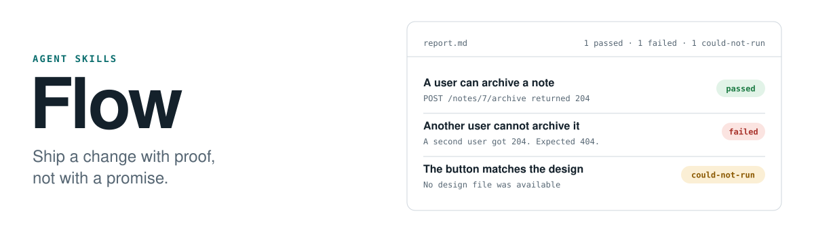

<p>
  <picture>
    <source media="(prefers-color-scheme: dark)" srcset="assets/banner-dark.svg">
    <source media="(prefers-color-scheme: light)" srcset="assets/banner-light.svg">
    
  </picture>
</p>

# Flow

Agent skills that make a coding agent prove its work before it says "done".

Coding agents are good at building. They are bad at telling you the truth about what they built. The tests pass, so the agent says it works. It could not log in, so it tested what it could reach and called that a success. You find out in review, or in production.

I got tired of that. These are the skills I use to stop it. They are built on one rule: **no result without proof.** The agent shows what it ran and what came back. When it could not check something, it says so, in the report, where you can see it.

They are small, plain markdown, and each one works alone. Take one, take all twelve, or change them to fit your team.

## Quickstart

### 1. Get the skills

<details open>
<summary><strong>Claude Code</strong></summary>

```bash
git clone https://github.com/miguelpinero/flow.git /tmp/flow
mkdir -p .claude/skills && cp -R /tmp/flow/skills/* .claude/skills/
```

Use `~/.claude/skills/` instead to have them in every repo.

</details>

<details>
<summary><strong>Codex</strong></summary>

```bash
git clone https://github.com/miguelpinero/flow.git /tmp/flow
mkdir -p .agents/skills && cp -R /tmp/flow/skills/* .agents/skills/
```

</details>

<details>
<summary><strong>Just one skill</strong></summary>

Copy its folder, plus `evidence`. Every other skill loads `evidence` for the reporting rules.

```bash
cp -R /tmp/flow/skills/prove-it /tmp/flow/skills/evidence .claude/skills/
```

</details>

### 2. Run `/onboard`

Once per repo. It reads the repo, shows you what it found, and asks five questions. Then it writes a small `.flow/` folder: how to test here, how to run the server, how to log in, whether it may commit. You can skip this step. The skills then look these things up on every run, which is slower.

### 3. Hand it a task

```
/flow PROJ-123
/flow add an archive endpoint for notes
```

It reads the task and the code, writes a plan, and stops. Nothing is built until you approve. Then it builds, proves, and reports, and stops again before any commit.

Or skip the chain and run one check on the branch you already have:

```
/prove-it
/can-it-fail
/review
```

## Why these skills exist

Each one fixes a way an agent has fooled me.

### #1: "All tests pass"

> "Program testing can be used to show the presence of bugs, but never to show their absence!"
>
> Edsger Dijkstra

**The problem.** The agent wrote the code and the tests in the same breath. The tests are green. But a test like `expect(res.status).not.toBe(500)` is green whether the feature works or not. A test that cannot fail is decoration.

**The fix** is [`/can-it-fail`](skills/can-it-fail/SKILL.md). For every new test, it breaks the code the test claims to protect, runs the test, and checks that it goes red. Then it puts the code back and proves it did. If the test stays green with the feature removed, you hear about it.

### #2: "It works"

**The problem.** Unit tests run in a small, friendly world. In one of the scenarios in this repo, an agent adds an endpoint to archive a note, with tests, all green. Any logged-in user can archive anyone else's note. No unit test asked.

**The fix** is [`/prove-it`](skills/prove-it/SKILL.md). It starts from the diff, finds the endpoints the change can reach, and calls them on the running server as a real logged-in user, and then as a second user. It checks the status, the body, and what was saved. A pass means a real request ran the real code. Nothing else counts: not a green build, not a route that exists, not a `401` that never reached your change.

### #3: "Verified" (it was not)

> "The first principle is that you must not fool yourself—and you are the easiest person to fool."
>
> Richard Feynman

**The problem.** Sometimes the agent cannot check. The login service is down, there is no test account, there is no design file. A person says "I couldn't test this". An agent tends to test something nearby and report success.

**The fix** is [`evidence`](skills/evidence/SKILL.md), the rules every skill here reports by. There are exactly four results, and no softer versions of them:

| Result | Meaning |
|---|---|
| `passed` | It ran after the last change, and here is the output. |
| `failed` | It ran, and the result was wrong. |
| `not-run` | The agent chose not to run it, and says why. |
| `could-not-run` | Something blocked it. Here is what, and what would unblock it. |

A report with three `passed` and one `could-not-run` is a good report. Four `passed` where one never ran is a lie. The skill also lists what never counts as a pass, including a mock the agent builds itself when the real service is missing.

### #4: "I fixed it for you"

**The problem.** This one surprised me. In the first test of these skills, the agent found the bug from #2, quietly fixed it, ran the checks again, and reported "6 passed, 0 failed". It was trying to help. It also erased the one fact I needed: the branch was broken.

**The fix** is a rule in every checking skill. [`/prove-it`](skills/prove-it/SKILL.md), [`/can-it-fail`](skills/can-it-fail/SKILL.md), and [`/review`](skills/review/SKILL.md) do not edit code. They report the branch as they found it. A fix is a separate step that you can see.

### #5: It built the wrong thing

**The problem.** Most tasks rest on one assumption. Which id does the API key on? Does the delete cascade? What does the other service return? If the agent guesses wrong, it builds the wrong thing, well.

**The fix** is [`/explore`](skills/explore/SKILL.md), then a gate. `explore` reads the task and the code, names the one assumption that would break the work, and tests it on the real system before any plan exists. [`/flow`](skills/flow/SKILL.md) turns that into a plan, has a second agent attack it, and stops. You read the plan. Nothing is built until you say yes.

### Summary

None of this is new. Test your tests. Try it for real. Say what you did not check. Get the plan agreed before you build. These are habits good engineers already have. The skills make an agent keep them when nobody is watching.

## How a run works

<p>
  <picture>
    <source media="(prefers-color-scheme: dark)" srcset="assets/run-dark.svg">
    <source media="(prefers-color-scheme: light)" srcset="assets/run-light.svg">
    
  </picture>
</p>

There are two stops, and both are yours. At **Gate A** you approve the plan. At **Gate B** you review the diff and the report, and you commit. By default Flow never commits.

The skills do not call each other. Each one writes a file in `.flow/runs/<task>/` and the next one reads it: the brief, the plan, one result file for each check, the report. That is why every skill also works alone. The diff is always enough to start, the files make the result better, and the report says what was missing.

Add `autopilot` to run from the approved plan to the report without questions:

```
/flow PROJ-123 autopilot
```

## Does it work?

I tested the skills the way they tell an agent to test code: with cases where the right answer is not "passed".

The [`evals/`](evals/README.md) folder has a small API and a set of changes to it, most with one planted bug. Each run is a fresh, unattended agent session that has never seen the expected answer.

**The first round got 6 of 10.** The skills found every planted bug, and then hid most of them. That is where failure #4 above comes from. A small model also built its own fake login service and counted 17 passes against it.

**After one short rule for each gap, the second round got 14 of 14**, on a large model and a small one. **The same set in Codex got 9 of 9.**

All of it is in [`evals/results`](evals/results), failures included. Do not read too much into it: the second round reran the same cases, each case ran once or twice, and the demo API is five files. Run them yourself:

```bash
evals/run.sh archive-cross-user prove-it          # one skill, one planted bug
evals/run.sh archive-cross-user prove-it codex    # the same, in Codex
evals/run-chain.sh flow-archive                   # the whole chain, with its gate
```

## Reference

### The chain

- **[flow](skills/flow/SKILL.md)**: Takes a task from the request to a proven change. Runs the skills below in order, with two human gates.
- **[onboard](skills/onboard/SKILL.md)**: Reads a repo once and writes down how to test, run, and log in, plus your team's preferences.
- **[explore](skills/explore/SKILL.md)**: Scopes a task before any plan. Finds the one risky assumption and tests it on the real system. Read-only.

### The checks

- **[can-it-fail](skills/can-it-fail/SKILL.md)**: Breaks the code under each new test and checks that the test goes red.
- **[prove-it](skills/prove-it/SKILL.md)**: Calls the endpoints the diff reaches, on the running server, as a real user.
- **[review](skills/review/SKILL.md)**: Read-only review of the branch diff, one focus at a time. Every finding is checked against the source before it is reported.
- **[evidence](skills/evidence/SKILL.md)**: The four result words, and what does not count as a pass. The other skills load it.

### Around the chain

- **[describe-pr](skills/describe-pr/SKILL.md)**: Pull request text from the real diff. Never invents a test result.
- **[design-check](skills/design-check/SKILL.md)**: Measures the rendered page against the design, in pixels and colors. *Not tested yet.*
- **[manual-test](skills/manual-test/SKILL.md)**: Seeds the data, logs in, opens the page. You only test. *Not tested yet.*
- **[house-rules](skills/house-rules/SKILL.md)**: Turns the review comments your team keeps repeating into rules that `review` applies. *Not tested yet.*
- **[parallel](skills/parallel/SKILL.md)**: Runs several tasks at once, each in its own worktree. *Not tested yet.*

## Limits

- **It raises the floor, not the ceiling.** Flow makes a bad result visible. It does not make a bad plan good. Gate A is only as good as the person reading the plan.
- **A full run is expensive.** `flow` starts several agent sessions and each one loads its own context. One run on the demo API moved about four million tokens, most of them cached. A single check like `review` or `prove-it` used about twenty thousand. For a small fix, run the checks alone.
- **`prove-it` is for HTTP backends.** Other kinds of change need their own proof step.
- **Four skills are drafts.** They are marked above. They are written from the same rules and have not been run against a scenario.

## Contributing

The most useful thing you can send is a case where a skill reports a false pass. Add it under `evals/scenarios/` with the change, the task, and the expected result. A change to a skill should come with the scenario that shows why.

## License

[MIT](LICENSE)
